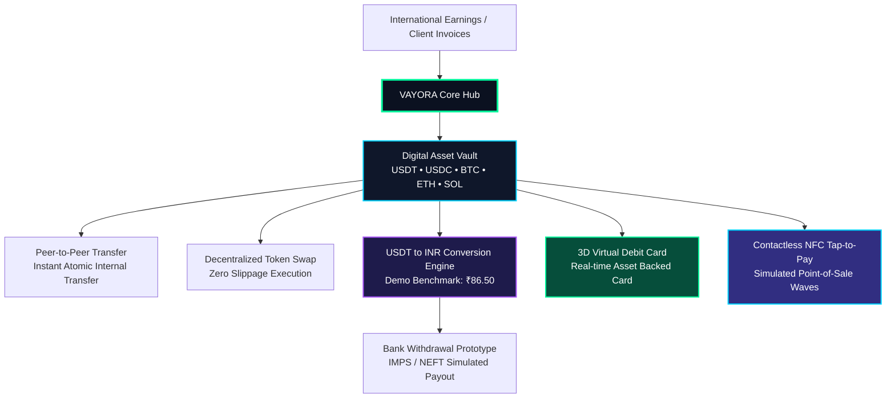
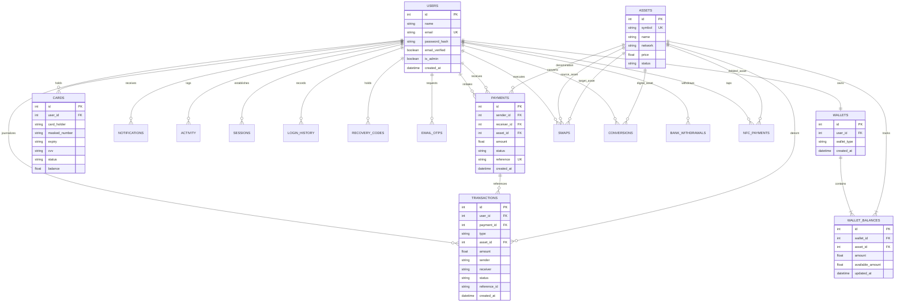

# VAYORA System Architecture Specification

**Product Identity:** VAYORA  
**Tagline:** *Your Digital Value, One Journey.*  
**Design Paradigm:** NEXA WORLD / NexaVault Futuristic Dark Fintech  
**Platform Type:** Unified Digital Asset & Cross-Border Payment Management Operating System (Controlled Academic / Demo Prototype)

---

## 1. System Vision & Core Value Pipeline

International earners, remote professionals, and digital freelancers receive remuneration across diverse currencies and networks. Traditional banking rails subject them to excessive intermediary fees, delayed settlements, and disjointed digital tooling.

VAYORA resolves this fragmentation through a unified multi-asset digital hub:

---

## 2. Architectural Layers

VAYORA is engineered with high separation of concerns across 4 distinct layers:

### 2.1 Presentation Layer (NEXA WORLD UI System)
- **Design Tokens**: Neon Emerald (`#00f59b`), Cyber Cyan (`#00d2ff`), Royal Purple (`#a855f7`), Electric Yellow (`#fbbf24`), Carbon Slate (`#0a0f1d`), Soft Glass (`rgba(255,255,255,0.03)`).
- **Component Architecture**: Persistent glowing sidebar with responsive collapsing, topbar status bar with real-time demo account switcher (`Demo Sender` / `Demo Receiver` / `Admin`), animated metric counters, interactive 3D card tilt & flip, and concentric NFC radar waves.
- **Accessibility & Motion**: Seamless support for standard CSS transitions paired with strict `prefers-reduced-motion` compliance.

### 2.2 API & Application Gateway Layer (FastAPI)
- **Authentication Gateway**: High-speed JWT issuing, Bcrypt password hashing, and 2-step email OTP verification.
- **Modular Routers**: 12 dedicated route modules (`auth`, `user`, `wallet`, `payments`, `transactions`, `swap`, `conversion`, `bank`, `card`, `nfc`, `security`, `admin`).
- **Dependency Injection**: Centralized database session handling and token parsing via `get_current_user` and `require_admin`.

### 2.3 Business Logic & Service Layer
- **`PaymentService`**: Dual-entry balance updates, verification of recipient existence, self-transfer guards, and atomic transaction persistence.
- **`WalletService`**: Real-time asset aggregation, live demo price multipliers, and portfolio valuation calculations.
- **`ConversionService`**: Safe simulated fiat calculations (USDT → INR) and prototype bank withdrawal validation.1
- **`SwapService`**: Dynamic quote generation and bi-directional atomic asset swaps.
- **`SecurityService`**: Session revocation, activity journaling, and suspicious login logging.

### 2.4 Persistence Layer (SQLAlchemy 2.0 & Relational SQLite)
- **Normalization**: 17 relational entities.
- **ACID Transactions**: Atomic commits guarantee that sender deduction and receiver credit occur together or fail completely.

---

## 3. Entity Relationship (ER) Diagram

---

## 4. Controlled Academic / Demo Prototype Boundaries

VAYORA explicitly differentiates between **production-grade software engineering** and **simulated financial infrastructure**:

| Platform Component | Technical Implementation | Demo / Academic Prototype Constraint |
|---|---|---|
| **Identity & Access** | Bcrypt hash + JWT tokens + 6-digit Email OTP | Academic test bypass: OTP `123456` or database-seeded OTPs |
| **Asset Balances** | Relational database atomic commits with transaction rollback | Simulated assets (USDT, USDC, BTC, ETH, SOL) with static/demo pricing |
| **Peer-to-Peer Transfer** | Full double-entry ledgering and validation | Occurs exclusively between registered internal VAYORA users |
| **USDT → INR Conversion** | Mathematical conversion with atomic deduction & INR balance credit | Demo exchange rate (₹86.50). **No actual banking settlement or FX clearing.** |
| **Bank Withdrawal** | Input validation (IFSC, Account number), balance debit, state progression | Simulated IMPS/NEFT payout rail without real SWIFT or RBI gateway |
| **Virtual Card** | Full 3D tilt/flip CSS, card freeze/unfreeze state mutations | Simulated BIN and card generation without real payment network (Visa/Mastercard) |
| **NFC Contactless** | Interactive POS animation and automated wallet debit | Simulated browser-based NFC terminal communication |
| **Compliance & Regulation** | Clean user directory and activity audit logs | **Strictly NO KYC verification module** and **Strictly NO Tax Records table** |
